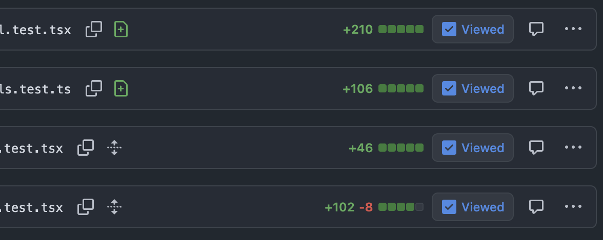

# gh-no-tests

Mark test files as **Viewed** and collapse their diffs on GitHub pull-request **Changes** pages.



```sh
git clone https://github.com/rashiq/gh-no-tests.git
```

1. Open `chrome://extensions`.
2. Turn on **Developer mode**.
3. Click **Load unpacked**.
4. Select the `gh-no-tests` folder.
5. Reload GitHub.

Clear **Viewed** to review a file. Use the extension panel to turn it off.
GitHub keeps the Viewed state.

Tests: `node --test tests/*.test.cjs`
